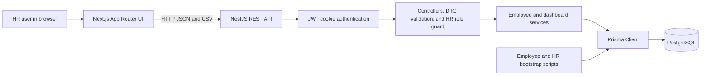

# ACME Salary Management System - Technical Documentation

**Document status:** Repository-derived documentation  
**Last reviewed:** 2026-10-14

## 1. Project Overview

ACME Salary Management System is a small HR/payroll application for reviewing employee compensation across countries and currencies. Its purpose is to replace spreadsheet-based salary review with a web dashboard backed by a PostgreSQL database.

The primary consumer is an HR or compensation operator using the browser dashboard. API clients authenticate with the HR-manager JWT cookie; bearer-token API clients are not implemented.

Implemented capabilities:

- Paginated employee directory with server-side search and filters.
- Payroll totals, employee counts, and average salaries grouped by currency.
- Country and department workforce/payroll analytics, also grouped by currency.
- Salary changes with effective dates and salary-history rows.
- HR-manager authentication using bcrypt password hashes and short-lived signed JWT cookies.
- HR-role authorization on employee, dashboard, analytics, salary, and CSV routes.
- Actor-attributed salary-change audit records written atomically with salary updates.
- CSV export using search, country, department, and currency filters.
- Deterministic, repeatable seed of 10,000 synthetic employee records.

The repository is a JavaScript/TypeScript npm-workspaces monorepo. The UI is a Next.js App Router application; the API is a NestJS REST application; Prisma accesses PostgreSQL. Runtime versions declared in the manifests are Next.js 16.4.0, React 19.3.0, NestJS 10.x, and Prisma 6.19.x. Node 20.20 was used for the verified builds and tests.

The present implementation is an assessment/demo foundation, not a production-ready payroll system. Authentication and HR-role authorization are implemented, but there is no employee create/delete API, currency conversion, rate limiting, password-reset flow, or production deployment configuration.

## 2. Project Structure

Relevant repository files (generated build output, dependencies, and local secrets are omitted):

```text
.
|-- README.md
|-- TECHNICAL_DOCUMENTATION.md
|-- package.json
|-- package-lock.json
|-- docker-compose.yml
|-- .gitignore
|-- .github/workflows/ci.yml
|-- backend/
|   |-- .env.example
|   |-- package.json
|   |-- eslint.config.mjs
|   |-- jest.config.js
|   |-- nest-cli.json
|   |-- tsconfig.json
|   |-- tsconfig.build.json
|   |-- prisma/
|   |   |-- schema.prisma
|   |   |-- seed.ts
|   |   |-- create-hr-manager.ts
|   |   `-- migrations/
|   |       |-- migration_lock.toml
|   |   |       |-- 20261014000000_initial/migration.sql
|   |   |       `-- 20261014103248_add_hr_auth_and_salary_audit/migration.sql
|   `-- src/
|       |-- main.ts
|       |-- app.module.ts
|       |-- app.controller.ts
|       |-- app.service.ts
|       |-- app.controller.spec.ts
|       |-- auth/
|       |   |-- auth.constants.ts
|       |   |-- auth.controller.ts
|       |   |-- auth.decorators.ts
|       |   |-- auth.e2e-spec.ts
|       |   |-- auth.module.ts
|       |   |-- auth.service.ts
|       |   |-- auth.types.ts
|       |   |-- current-user.decorator.ts
|       |   |-- jwt-auth.guard.ts
|       |   |-- login.dto.ts
|       |   `-- roles.guard.ts
|       |-- prisma/
|       |   |-- prisma.module.ts
|       |   `-- prisma.service.ts
|       `-- employees/
|           |-- employees.module.ts
|           |-- employees.controller.ts
|           |-- employees.service.ts
|           |-- employees.types.ts
|           |-- employee-query.dto.ts
|           |-- salary-update.dto.ts
|           `-- employees.service.spec.ts
`-- frontend/
    |-- package.json
    |-- eslint.config.mjs
    |-- jest.config.js
    |-- next.config.mjs
    |-- tsconfig.json
    |-- tailwind.config.ts
    |-- postcss.config.js
    |-- next-env.d.ts
    `-- app/
        |-- layout.tsx
        |-- page.tsx
        |-- page.test.tsx
        `-- globals.css
```

Important files:

| File | Responsibility |
|---|---|
| `package.json` | Root workspace definitions and combined development, build, test, and database setup commands. |
| `docker-compose.yml` | Local PostgreSQL 16 service and persistent data volume. It does not containerize the API or frontend. |
| `backend/src/main.ts` | NestJS bootstrap, `/api` prefix, CORS, validation pipe, and API port. |
| `backend/src/auth/` | Login/logout/identity routes, bcrypt verification, JWT cookie handling, public-route metadata, authentication guard, role guard, and HTTP auth tests. |
| `backend/src/app.module.ts` | Root Nest module and module registration. |
| `backend/src/employees/` | Employee routes, input DTOs, database access, serialization, salary changes, analytics, and service tests. |
| `backend/src/prisma/` | Nest provider lifecycle for the generated Prisma client. |
| `backend/prisma/schema.prisma` | PostgreSQL data model and Prisma client generator. |
| `backend/prisma/migrations/` | Checked-in initial and additive auth/audit PostgreSQL migrations. |
| `backend/prisma/seed.ts` | Deterministic 10,000-employee development seed. |
| `backend/prisma/create-hr-manager.ts` | Development-only create-once HR manager bootstrap using environment credentials and bcrypt. |
| `backend/.env.example` | Example PostgreSQL URL and API port for the Compose database. Local `backend/.env` is ignored and must not be committed. |
| `frontend/app/page.tsx` | Client-side dashboard, employee filters, pagination, CSV download, and salary edit form. |
| `frontend/app/page.test.tsx` | Login/logout, expiry, API error, filtering, pagination, and salary update UI tests. |
| `.github/workflows/ci.yml` | Pull-request/main-branch install, lint, test, and build validation; it does not deploy. |
| `frontend/app/layout.tsx` | Root HTML layout and page metadata. |
| `frontend/app/globals.css` | Global styling and dashboard component classes. |
| `backend/jest.config.js` | Jest/ts-jest configuration for backend `*.spec.ts` files. |
| `backend/nest-cli.json`, `backend/tsconfig*.json` | Nest CLI and TypeScript build configuration. |
| `frontend/next.config.mjs`, `frontend/tsconfig.json` | Next.js and TypeScript configuration. |

`frontend/AGENTS.md` may appear after running `next dev`; it is generated by Next.js for agent guidance and is not part of the application runtime. `.github/workflows/ci.yml` validates but does not deploy. There is no deployment workflow. `node_modules/`, `backend/dist/`, and `frontend/.next/` are generated and intentionally excluded from this tree.

## 3. Architecture Overview

The frontend makes credentialed browser-side HTTP requests to the NestJS API. The API validates a short-lived JWT from an HttpOnly cookie, reloads the active user from PostgreSQL, and applies HR-role checks before employee routes. Controllers bind validated values, services construct Prisma queries/transactions, and Prisma accesses PostgreSQL. There are no queues, background workers, external APIs, or object-storage integrations.



Request lifecycle:

1. The Nest application starts in `backend/src/main.ts`, validates JWT/CORS configuration, registers `/api`, enables credentialed CORS only for configured origins, parses cookies, and installs a global `ValidationPipe`.
2. The global JWT guard allows only explicitly marked public routes. Protected requests verify HS256, issuer, audience, and expiry; the guard reloads the active user from PostgreSQL. A second global guard enforces route metadata roles.
3. A controller receives the authenticated principal and request. Employee list query parameters are transformed and validated using `EmployeeQueryDto`; salary updates use `UpdateSalaryDto`.
4. `EmployeesService` constructs database filters, aggregate queries, or a transaction through the injected `PrismaService`.
5. Prisma executes the operation against the configured PostgreSQL schema.
6. The service converts Prisma Decimal/date values to API values; Nest serializes returned objects as JSON. The CSV route sets download headers and sends a string body.

Salary update lifecycle:

1. The service verifies that the employee exists.
2. The global guard supplies the authenticated actor ID. Inside one Prisma transaction the service updates current compensation, inserts a `SalaryHistory` row, and inserts a `SalaryChangeAudit` row containing old/new compensation and actor.
3. The updated employee is returned to the UI. The UI then reloads its summary and employee page.

## 4. Core Modules and Business Logic

### Bootstrap and modules

- `main.ts` calls `NestFactory.create(AppModule)`, sets the API prefix, configures CORS and validation, and listens on `PORT` or port `4000`.
- `AppModule` imports `PrismaModule`, `AuthModule`, and `EmployeesModule`; it registers the JWT and roles guards as global guards.
- `PrismaModule` is global and provides `PrismaService`.
- `PrismaService` extends the generated Prisma client, connects on Nest module initialization, and disconnects on module destruction.
- `EmployeesModule` registers its controller/service and exports the service for the dashboard summary route.

### Authentication module

- `AuthService.login()` normalizes the email, performs bcrypt comparison (including a dummy hash for unknown users), and creates a 15-minute HS256 JWT only for active HR managers.
- `AuthController` exposes public login/logout and protected `GET /auth/me`; password hashes and JWTs are not serialized in response bodies.
- `JwtAuthGuard` checks cookie signature, algorithm, issuer, audience, expiration, and current database user state for every non-public request. `RolesGuard` enforces `@Roles(UserRole.HR_MANAGER)` metadata.
- `create-hr-manager.ts` is a development-only create-once bootstrap. It reads email/password from the environment, hashes with bcrypt, refuses production mode, and refuses to overwrite an existing email.

### Employee service

`EmployeesService` in `backend/src/employees/employees.service.ts` owns the employee data operations:

- `getSummary()` runs a count and database `groupBy` aggregates. Totals and averages are keyed by currency; there is no combined cross-currency payroll number.
- `listEmployees()` applies optional search, country, department, currency, and salary-bound filters. It uses `count`, `skip`, and `take` in PostgreSQL rather than loading the entire roster into the browser. The default page size is 10 and the service caps it at 100. Requested pages are clamped to the final page.
- `findById()` looks up a single employee and raises Nest `NotFoundException` when absent.
- `updateSalary()` updates current employee fields and atomically inserts both salary history and a salary audit record. The actor ID comes from the authenticated request principal.
- `getAnalytics()` groups country/currency and department/currency combinations, returning count, sum, and average per group.
- `exportCsv()` queries all rows matching its supported filters, quotes CSV cells, escapes embedded double quotes, and prefixes formula-leading cells (including values with leading whitespace/control bytes) with an apostrophe.

Search is case-insensitive substring matching against employee code, full name, department, and country. Country and department filters are exact matches. Salary boundaries are numeric values in the employee's stored currency; there is no currency normalization or exchange-rate integration.

`employee-query.dto.ts` validates list query inputs: page and limit are positive integers, limit is at most 100, search is at most 200 characters, country and department are at most 100 characters, currency is one of USD/EUR/GBP/INR, and salary bounds are nonnegative with at most two decimal places.

`salary-update.dto.ts` requires a salary greater than zero with at most two decimal places, a supported currency, and an ISO date string. The UI submits a date-only value. The currency may be changed with the salary; the service does not calculate a foreign-exchange conversion.

Global validation uses `whitelist: true`, `transform: true`, and `forbidNonWhitelisted: true`. Unknown properties in DTO-bound bodies/queries are rejected. The CSV route binds filters individually and does not use `EmployeeQueryDto`.

## 5. API Documentation

The API is prefixed with `/api`. Only `GET /api/health`, `POST /api/auth/login`, and `POST /api/auth/logout` are public. All other routes require a valid session cookie; employee, dashboard, analytics, salary, and export routes additionally require the `HR_MANAGER` role. Login/logout use Nest's default POST success status (`201`); GET/PATCH routes normally return `200`. CSV export returns `text/csv` with an attachment disposition.

| Method and endpoint | Purpose and inputs | Successful response |
|---|---|---|
| `POST /api/auth/login` | Public login. JSON body: `email`, `password`. | `{ "user": { "id": 1, "email": "hr@example.test", "role": "HR_MANAGER", "expiresAt": "2026-10-14T12:15:00.000Z" } }`; sets the `acme_session` cookie. |
| `GET /api/auth/me` | Return the current authenticated identity. | Same safe user object including `expiresAt`; no password hash or JWT in the response body. |
| `POST /api/auth/logout` | Public logout; expires the session cookie. | `{ "message": "Logged out." }` and a clearing `Set-Cookie` header. |
| `GET /api/health` | Public static health response; it does not query PostgreSQL. | `{ "status": "ok" }` |
| `GET /api` | Basic service message. Requires authentication. | `{ "message": "ACME Salary Management API is running" }` |
| `GET /api/dashboard/summary` | HR-manager dashboard summary. | `totalEmployees`, `averageSalaryByCurrency[]`, `payrollByCurrency[]` (includes `employeeCount`), `countries[]`, `departments[]`. Every salary aggregate is associated with a currency. |
| `GET /api/employees` | HR-manager paginated list. Query: `page`, `limit`, `search`, `country`, `department`, `currency`, `minSalary`, `maxSalary`. | `{ data: Employee[], page, limit, total, totalPages }` |
| `GET /api/employees/analytics` | HR-manager country and department analytics. | `{ byCountry: [{ country, currency, count, average, total }], byDepartment: [{ department, currency, count, average, total }] }` |
| `GET /api/employees/export` | HR-manager CSV export. Supports `search`, `country`, `department`, and `currency`. | CSV attachment named `employees.csv`. It does not accept salary-bound filters or pagination. |
| `GET /api/employees/:id` | HR-manager fetch by integer ID. | One `Employee` object. |
| `PATCH /api/employees/:id/salary` | HR-manager updates salary, currency, and effective date; authenticated actor is taken from the validated principal, never from the body. | Updated `Employee` object. |

The public employee representation is:

```json
{
  "id": 1,
  "employeeId": "ACM-00001",
  "fullName": "Example Person",
  "department": "Engineering",
  "country": "India",
  "currency": "INR",
  "salary": 1800000,
  "effectiveDate": "2025-01-01"
}
```

The list endpoint example is:

```json
{
  "data": [],
  "page": 1,
  "limit": 10,
  "total": 10000,
  "totalPages": 1000
}
```

Salary update request:

```http
PATCH /api/employees/1/salary
Content-Type: application/json
```

```json
{
  "salary": 2000000,
  "currency": "INR",
  "effectiveDate": "2025-02-01"
}
```

Common errors:

| Condition | Status/behavior |
|---|---|
| Missing, invalid, expired, or unverifiable session cookie | `401 Unauthorized`. |
| Valid authenticated user without the required role | `403 Forbidden`. |
| Invalid login or inactive/non-HR account | Generic `401` message: `Invalid email or password.`; user lookup details are not returned. |
| Invalid DTO value, unknown DTO property, or invalid integer path ID | Nest validation/`ParseIntPipe` returns `400 Bad Request`. |
| Employee ID does not exist | `NotFoundException`, returned as `404 Not Found`. |
| Database unavailable or unhandled Prisma error | No custom database exception mapping is implemented; startup connection failure or a default server error may result. |
| Browser cannot reach API | UI displays an error banner; check API URL, server status, CORS, and database connection. |

Login passwords are 12-72 UTF-8 bytes. Login email is trimmed and lowercased. Password hashes are never returned. There is no Swagger/OpenAPI route or API versioning. Request/response examples above are based on DTOs, controller signatures, and service serialization.

## 6. Database and Data Model

The database is PostgreSQL. Prisma 6.19.x generates the typed client and manages queries. `DATABASE_URL` selects the database and schema.

### Models

| Model | Fields and constraints |
|---|---|
| `User` | Integer primary key; unique normalized email; bcrypt password hash; `UserRole` enum; active flag; created/updated timestamps. User records relate to salary audit rows. |
| `Employee` | Integer autoincrement primary key; unique `employeeCode`; `fullName`, `department`, and `country`; `Currency` enum; `salary DECIMAL(14,2)`; date-only `effectiveDate`; `createdAt` and `updatedAt`; one-to-many relationship to salary history. |
| `SalaryHistory` | Integer autoincrement primary key; employee foreign key; `salary DECIMAL(14,2)`; currency; date-only effective date; creation timestamp. Employee deletion cascades to these rows at the database relationship level, although no employee deletion API exists. |
| `SalaryChangeAudit` | Integer primary key; actor user and employee foreign keys; previous/new `DECIMAL(14,2)` salary and currency; effective date; `changedAt` timestamp. FKs restrict deleting referenced users/employees. |
| `Currency` | PostgreSQL enum: `USD`, `EUR`, `GBP`, `INR`. |
| `UserRole` | PostgreSQL enum: `HR_MANAGER`, `EMPLOYEE`. |

Indexes in `schema.prisma` cover employee country/department, currency/salary, full name, and salary history employee/effective-date. The employee code has a unique index. The history foreign key references `Employee.id` with delete cascade.

The initial migration is `backend/prisma/migrations/20261014000000_initial/migration.sql`. Authentication/audit schema is added by `backend/prisma/migrations/20261014103248_add_hr_auth_and_salary_audit/migration.sql`; it creates the new enum/tables/indexes/FKs without modifying or deleting `Employee` rows. `npm run db:migrate --workspace backend` runs `prisma migrate dev`; this is a development migration command and may detect a reset requirement if pointed at an unrelated schema. Do not reset a database containing unrelated data. The repository does not define a `migrate deploy` production script.

`npm run db:push --workspace backend` runs Prisma schema push without creating a migration. Use migrations as the source of schema history for normal development.

The seed script inserts 10,000 deterministic employees in batches of 1,000. Employee codes are stable (`ACM-00001` through `ACM-10000`); names, departments, markets, salaries, and effective dates are generated from fixed arrays and index-based formulas. `createMany({ skipDuplicates: true })` makes repeated runs skip existing employee codes. It does not clear a database, update existing seeded employees, or seed initial salary-history rows.

Prisma uses Decimal values in the database. Service serialization converts salary and aggregates to JavaScript `number` for JSON responses; consumers should not use this representation for arbitrary-precision financial arithmetic.

## 7. Authentication and Security

### Authentication flow

- `POST /api/auth/login` normalizes email, finds the user, and compares the password with `bcryptjs` (12 rounds). A dummy bcrypt hash is compared for unknown email addresses so the obvious lookup path does not skip password-hash work. Login accepts only active `HR_MANAGER` accounts and returns one generic 401 message for invalid credentials.
- On success, `AuthService` signs a 15-minute JWT using HS256, a configured issuer and audience, and the user's integer ID as the subject. The token is placed only in the `acme_session` cookie; the response body contains `{ id, email, role, expiresAt }`, never the token or password hash.
- The cookie is HttpOnly, SameSite=Strict, scoped to `/api`, and marked Secure when `NODE_ENV=production`. The frontend uses `credentials: 'include'` and does not store bearer tokens in JavaScript storage.
- `GET /api/auth/me` returns the authenticated principal. `POST /api/auth/logout` clears the browser cookie. The JWT is stateless and cannot be revoked server-side; a copied token remains usable until its 15-minute expiry unless the account is deactivated.
- Every protected request verifies algorithm, signature, issuer, audience, and expiry, then reloads the user by subject and checks `isActive`. Current role/email are read from PostgreSQL rather than trusted from a JWT role claim.

### Authorization

`JwtAuthGuard` is registered globally through `APP_GUARD`. Only handlers marked with `@Public()` bypass it: login, logout, and the static health route. The legacy root greeting and all other routes require a valid session. `RolesGuard` is also global; `@Roles(UserRole.HR_MANAGER)` is applied to dashboard summary and the complete employee controller, covering list, detail, analytics, salary update, and CSV export. An authenticated user with a different role receives 403.

### Other controls and remaining risks

- `LoginDto` validates normalized email and password length (12-72 UTF-8 bytes); `UpdateSalaryDto` and `EmployeeQueryDto` retain request validation. Global validation uses whitelist/transform/forbid-unknown-property options.
- `JWT_SECRET` is required at startup and must contain at least 32 bytes. There is no default secret or production bypass.
- CORS accepts only the explicit comma-separated `CORS_ORIGINS` list and permits credentials for those origins. Browser requests use the matching API origin setting.
- Salary update, `SalaryHistory` insert, and `SalaryChangeAudit` insert share one Prisma transaction. The audit includes actor, employee, prior/new compensation, effective date, and database timestamp.
- CSV export neutralizes values whose first non-whitespace/control character is `=`, `+`, `-`, or `@`, in addition to normal CSV quote escaping. This reduces spreadsheet formula execution risk for exported text values.
- `.env` files are ignored by `.gitignore`; examples use placeholders or local-only Compose values. Never commit credentials.
- There is no rate limiter, password-reset/account-recovery flow, or server-side token revocation. SameSite=Strict and strict CORS reduce cross-origin browser risk, but there is no CSRF token or explicit Origin/Referer validation; add a deliberate CSRF strategy before relaxing cookie SameSite policy or supporting cross-site clients.
- No account-management endpoint exists. The development bootstrap command is create-once and runs only when `NODE_ENV=development`.
- CORS/cookie security assumes production HTTPS termination; the repository does not configure TLS itself.
- CSV quoting handles double quotes but does not neutralize spreadsheet formula prefixes. Review formula injection risk before exporting user-controlled text to spreadsheet software.
- Development PostgreSQL credentials in `.env.example` and `docker-compose.yml` are for local-only use.

## 8. External Integrations

The only external runtime dependency is PostgreSQL, reached through Prisma using `DATABASE_URL`. The frontend uses browser `fetch` to call the backend REST API. No third-party APIs, identity provider, queue, object store, email system, or background scheduler appears in the repository.

The `lucide-react` package supplies UI icons; it does not represent a network integration.

## 9. Configuration and Environment Variables

| Variable | Required? | Default | Purpose and expected format |
|---|---|---|---|
| `DATABASE_URL` | Required for Prisma/database operations | None in schema | PostgreSQL connection URL, for example `postgresql://<user>:<password>@<host>:5432/<database>?schema=<schema>`. Set a schema dedicated to this application when sharing a database. |
| `PORT` | Optional | `4000` | NestJS listen port, read by `main.ts`. |
| `NODE_ENV` | Optional at API runtime; required as `development` for bootstrap | No application default | Controls the cookie `Secure` attribute (`true` only for `production`). The initial HR bootstrap refuses to run unless this is exactly `development`. |
| `JWT_SECRET` | Required | None; startup fails if absent or shorter than 32 bytes | HS256 signing key. Generate a unique random value and keep it out of source control and logs. |
| `CORS_ORIGINS` | Required | None; startup fails if empty | Comma-separated exact allowed frontend origins, e.g. `http://localhost:3000`; credentialed CORS is restricted to these origins. |
| `INITIAL_HR_EMAIL` | Bootstrap-only required | None | Email for the first HR-manager account; not read by the running API. |
| `INITIAL_HR_PASSWORD` | Bootstrap-only required | None | Initial password of 12-72 UTF-8 bytes; hashed with bcrypt by the development-only bootstrap command. |
| `NEXT_PUBLIC_API_URL` | Optional | `http://localhost:4000/api` | Frontend API base URL, read in `frontend/app/page.tsx`. Because it is a public Next.js variable, it must not contain credentials or secrets. |

`backend/.env.example` contains local Compose-compatible database values and placeholders for auth/CORS settings. `frontend/.env.example` does not exist. `main.ts` loads dotenv, Prisma reads `DATABASE_URL` directly, and the browser build reads `NEXT_PUBLIC_API_URL`. The Nest `ConfigModule` dependency is present in the manifest but is not imported; there is no custom configuration module. Do not document or commit real values from the ignored `backend/.env`.

Variables such as `DB_HOST`, `DB_USER`, `DB_PASSWORD`, and `DB_SSL` are not read by application code in this repository; configure Prisma through `DATABASE_URL`.

## 10. Installation and Local Setup

### Prerequisites

- Node.js 20.20 was used for verified builds/tests; Next.js 16 requires a supported modern Node runtime.
- npm with workspace support.
- PostgreSQL 16, either from the provided Compose file or a separately managed instance.
- Docker Compose only if using the bundled local database service.

### Setup with the bundled database

Run from the repository root in PowerShell:

```powershell
npm install --legacy-peer-deps
docker compose up -d postgres
if (!(Test-Path backend/.env)) { Copy-Item backend/.env.example backend/.env }
$env:NODE_ENV = 'development'
npm run db:setup
npm run auth:bootstrap --workspace backend
npm run dev
```

Before running, set `JWT_SECRET`, `CORS_ORIGINS`, `INITIAL_HR_EMAIL`, and `INITIAL_HR_PASSWORD` in the ignored `backend/.env`. Generate a local signing key with `node -e "process.stdout.write(require('crypto').randomBytes(48).toString('base64url'))"`; keep it private and do not commit it. The bootstrap requires `NODE_ENV=development`, hashes the password, and never overwrites an existing account.

The example connection uses the database and credentials created by `docker-compose.yml`; keep those credentials local only. If `backend/.env` already exists, preserve it and confirm its `DATABASE_URL` targets a database/schema reserved for this application. `prisma migrate dev` must not be allowed to reset an unrelated schema. The authentication/audit migration only adds new objects and has been applied without resetting employee data.

The Compose service has a health check and persists data in the named `salary-postgres` volume. It starts PostgreSQL only; the API and frontend run as local Node processes.

### Separate startup and common commands

```powershell
npm run start:dev --workspace backend
npm run dev --workspace frontend
npm run build
npm test
```

Root `npm run dev` uses `concurrently` to start both services. The frontend defaults to `http://localhost:3000`; the backend defaults to `http://localhost:4000/api`.

Relevant backend commands from `backend/package.json`:

| Command | Effect |
|---|---|
| `npm run prisma:generate --workspace backend` | Generate Prisma Client from `prisma/schema.prisma`. |
| `npm run db:migrate --workspace backend` | Run `prisma migrate dev`. |
| `npm run db:push --workspace backend` | Push Prisma schema directly without migration history. |
| `npm run db:seed --workspace backend` | Run `prisma/seed.ts`. |
| `npm run auth:bootstrap --workspace backend` | Create the first HR manager from `INITIAL_HR_EMAIL` and `INITIAL_HR_PASSWORD` in development only; exits if the email exists. |
| `npm run test --workspace backend` | Run backend Jest tests serially. |
| `npm run build --workspace backend` | Compile Nest application. |

`npm run db:setup` at the root runs the migration followed by the seed. The seed is safe to rerun for existing employee codes and does not delete rows.

## 11. Execution and Operational Workflows

### Dashboard use

1. The browser checks `GET /api/auth/me`; protected dashboard data is not rendered until an HR manager is authenticated.
2. Credentials are posted to `/api/auth/login`; the browser sends the HttpOnly cookie with subsequent requests using `credentials: 'include'`.
3. The browser loads summary and employee records. Search is debounced by 180 ms; country, department, and currency filters are server-side, with 10 rows per page.
4. Selecting a country applies the directory filter. Export uses the current search/country/department/currency filters and returns all matches, not only the visible page.
5. Salary editing sends employee ID, salary, currency, and effective date. The API atomically updates compensation and writes salary history and an audit row with the actor.
6. The client clears protected data and returns to sign-in at the server-provided token expiry, and also does so immediately if a protected request returns 401. Sign-out posts to `/api/auth/logout` and clears the browser cookie. A copied JWT cannot be revoked and remains valid until expiry unless the account is deactivated.

### Development data operations

- First setup: apply migration and seed through root `npm run db:setup`.
- Repeat seed: run `npm run db:seed --workspace backend`; duplicate employee codes are skipped.
- There are no scheduled jobs, retry queues, or background ETL workflows.

## 12. Deployment and Infrastructure

The repository contains only a PostgreSQL development service in `docker-compose.yml`. There are no API/frontend Dockerfiles, Kubernetes or Terraform definitions, cloud environment definitions, or production release procedure. `.github/workflows/ci.yml` runs install, lint, tests, and builds on pull requests and pushes to `main`; it does not deploy.

The workspace build command compiles the backend and creates a Next.js production build:

```bash
npm run build
```

The backend can be started with `npm run start --workspace backend`; the frontend has `npm run start --workspace frontend`. Production database migration automation, secret injection, TLS, health/readiness probes, and process supervision are not defined. The `GET /api/health` route returns a static status and does not establish database readiness.

Do not treat the provided Compose credentials as production settings. Use a production secret manager, exact CORS origins, HTTPS, and a production-safe migration process. The repository does not provide deployment automation.

## 13. Error Handling, Logging, and Monitoring

- Nest built-in exceptions are used for missing employees (`NotFoundException`). `ParseIntPipe` handles invalid integer IDs. The global validation pipe returns standard Nest validation errors for invalid DTOs.
- No global exception filter or Prisma-specific error mapper is configured.
- Startup logs use Nest's default logger. Salary changes are persisted to `SalaryChangeAudit`, but there is no audit query API, custom structured/request logging, log file configuration, metrics, tracing, alerting, or monitoring integration.
- Prisma connection is awaited during module initialization; an unavailable database can prevent application startup. No application-level reconnect/retry policy is configured.
- The seed script writes a completion count to stdout and an error to stderr; it sets a nonzero process exit code on failure and disconnects Prisma in `finally`.
- The UI catches fetch/export/update failures and displays an error banner. It does not have offline caching or automatic retry behavior.

Operationally, verify PostgreSQL availability, `DATABASE_URL`, migration state, API port, and `NEXT_PUBLIC_API_URL` first when requests fail. The static health route alone is not proof that payroll queries can succeed.

## 14. Testing and Quality Assurance

Backend tests use Jest 29 and `ts-jest`, configured by `backend/jest.config.js`. `employees.service.spec.ts` mocks Prisma and covers currency aggregates, pagination/serialization, page clamping, transactional history/audit writes, formula-injection neutralization for `=`, `+`, `-`, `@`, leading whitespace/control bytes, ordinary quote escaping, and not-found behavior. `auth.e2e-spec.ts` creates a Nest HTTP test app with mocked Prisma and covers successful login and identity without hash disclosure, failed login, logout cookie clearing, anonymous route denial, role enforcement, protected CSV, and salary audit attribution. `app.controller.spec.ts` is a controller smoke test. These tests do not connect to PostgreSQL and are not database integration tests.

Frontend component tests use Jest 29, `jest-environment-jsdom`, React Testing Library, and `user-event`, configured by `frontend/jest.config.js`. `frontend/app/page.test.tsx` covers login/logout, expired restored sessions, API errors, employee search/filters, pagination, and salary updates. These are component tests with mocked HTTP fetches, not browser automation.

The root `npm test` runs both workspace suites. The current suite contains 22 backend tests across three suites and 6 frontend tests across one suite. No coverage percentage has been measured.

Lint command status:

- Backend lint uses ESLint 9 flat config at `backend/eslint.config.mjs` and runs with `--max-warnings=0`; it does not auto-fix.
- Frontend lint uses Next 16's ESLint presets from `frontend/eslint.config.mjs` and runs with `--max-warnings=0`; it does not invoke the removed `next lint` subcommand.
- Root `npm run lint` runs both workspace linters. `.github/workflows/ci.yml` invokes root lint, tests, and builds.
- No formatter command is configured.

Verified build/test commands are `npm run build` and `npm test` at the repository root.

## 15. Troubleshooting Guide

| Symptom | Likely cause / investigation | Resolution |
|---|---|---|
| API startup says `JWT_SECRET` is missing/short or `CORS_ORIGINS` is empty | Startup is deliberately fail-closed for auth/CORS configuration. | Set a unique secret of at least 32 bytes and exact comma-separated frontend origins in ignored `backend/.env`. |
| Login returns `401` | Invalid credentials, inactive user, or account role is not `HR_MANAGER`; responses are intentionally generic. | Check the local bootstrap variables/account. There is no password-reset or account-management endpoint. |
| A protected route returns `401` or `403` | Session missing/expired/invalid (`401`) or authenticated role is insufficient (`403`). | Confirm cookie acceptance, use `/api/auth/me`, sign in again, and verify active database role. |
| Browser reports a CORS/preflight error | UI origin is not an exact member of `CORS_ORIGINS`, or API base URL is wrong. | Add the exact UI origin and set `NEXT_PUBLIC_API_URL`; restart/rebuild. Do not use wildcard credentialed CORS. |
| `P1000` authentication failure during migration | PostgreSQL rejected the URL credentials. Confirm the target server, user, password, port, and URL encoding without exposing credentials in logs. | Update the ignored `backend/.env` `DATABASE_URL` to valid local credentials and retry against a dedicated database/schema. |
| Prisma reports schema drift and suggests a reset | The URL points to a database/schema with tables not represented by this app's migration history. | Stop. Do not reset an unrelated schema. Use an isolated schema/database and apply the app migration there. |
| API exits or does not serve routes when starting | Prisma connection is awaited during Nest startup. Inspect startup logs and database reachability. | Verify PostgreSQL is running and `DATABASE_URL` resolves from the backend process. |
| Browser shows dashboard API error | API is stopped, the URL is wrong, CORS blocks the origin, or the database is unavailable. | Confirm `http://localhost:4000/api/health`, then test `/api/dashboard/summary`; set `NEXT_PUBLIC_API_URL` before starting/building Next.js if the API is elsewhere. |
| `GET /api/employees` returns 400 | A query value failed DTO validation, such as unsupported currency, non-integer page, `limit > 100`, or invalid salary bounds. | Use the parameter constraints documented in Section 5 and send numeric values in the accepted format. |
| ESLint reports a flat-config rule violation | The backend and frontend lint commands use ESLint 9 flat configs and fail on errors/warnings. | Fix the reported source/config issue, then rerun `npm run lint`; these commands do not auto-fix files. |
| `npm install` reports peer dependency conflicts | Workspace manifests include multiple framework/plugin peer ranges. The documented setup uses the legacy peer resolver. | Use `npm install --legacy-peer-deps` and verify the installed package tree before changing versions. |
| Seed reports duplicate employee codes | The deterministic seed has already inserted those codes. `skipDuplicates` is expected. | Rerun is safe; inspect the final count printed by the script. Existing rows are not overwritten. |

## 16. Developer Maintenance Guide

### Add or change an API route

1. Add the route to `EmployeesController` or the appropriate controller.
2. Define and apply a DTO for user-controlled query/body fields; global validation only validates DTO-bound values.
3. Implement business/database behavior in the corresponding service using Prisma.
4. Preserve the public serializer mapping in `EmployeesService` if the database field names differ from API names.
5. Add a focused test in the relevant `*.spec.ts` file and run `npm test`.

### Change the database model

1. Edit `backend/prisma/schema.prisma`.
2. Generate the client with `npm run prisma:generate --workspace backend`.
3. Create/apply a development migration with `npm run db:migrate --workspace backend` against a dedicated database/schema.
4. Review the generated migration and update seed data or service queries as required.
5. Do not use `db:push` as a replacement for committed migration history.

### Change environment configuration

Update the Prisma schema or actual config reader and the safe `.env.example` together. Do not add real credentials to tracked files. `NEXT_PUBLIC_*` values are exposed to the browser and must never contain secrets.

### Add tests

Backend unit and Nest HTTP tests mock Prisma as shown in `employees.service.spec.ts` and `auth.e2e-spec.ts`. For real database behavior, add an explicitly provisioned integration-test database and test setup; none is currently configured. Frontend component tests live in `frontend/app/page.test.tsx`; browser automation is not configured.

## 17. Known Limitations and Technical Debt

Observed implementation gaps:

- The JWT is stateless: logout clears the client cookie but cannot revoke a copied token before its 15-minute expiry.
- There is no rate limiting, password reset/account recovery, or account-administration API.
- Cookie CSRF defenses rely on SameSite=Strict and CORS allowlisting; there is no CSRF token or explicit Origin/Referer check.
- No employee create/delete endpoints; current API supports read/list and salary patch only.
- Audit rows are stored, but there is no audit query API, retention policy, or monitoring integration.
- No initial salary-history row is created by the seed; history begins with later salary changes.
- Salary update writes the submitted currency and amount as-is; there is no FX conversion or policy check for changing currencies.
- Salary JSON values are converted from Prisma Decimal to JavaScript number.
- CSV export fetches all matched rows into memory and does not apply salary-bound filters or pagination. Formula-leading fields are apostrophe-prefixed, but spreadsheet compatibility should still be verified across target spreadsheet applications.
- Frontend tests are component-level with mocked HTTP, not browser automation; backend database access tests also mock Prisma.
- No production migration command, deployment automation, app containers, or production infrastructure configuration. The CI workflow is verification-only.
- The latest install emitted an npm audit report of 67 vulnerabilities (4 low, 17 moderate, 46 high); review the current lockfile audit before release because advisories change over time.

Recommendations above are not implemented behavior. Treat this codebase as a local assessment/demo until security controls, operational practices, and payroll-specific approval/audit requirements are added.

## 18. Dependencies

Versions below are declared ranges/values in the workspace manifests, not a claim that every dependency is directly used by every code path.

| Workspace | Dependency | Declared version | Purpose |
|---|---|---:|---|
| Root | `concurrently` | `^9.0.1` | Start frontend and backend together. |
| Backend | `@nestjs/common`, `@nestjs/core`, `@nestjs/platform-express` | `^10.4.15` | Nest API framework and Express HTTP adapter. |
| Backend | `@nestjs/config` | `^3.3.0` | Installed config package; no `ConfigModule` is imported in the current source. |
| Backend | `@prisma/client`, `prisma` | `^6.19.3` | PostgreSQL ORM client, schema/migrations CLI. |
| Backend | `class-validator`, `class-transformer` | `^0.14.1`, `^0.5.1` | DTO validation and query transformation. |
| Backend | `bcryptjs`, `jsonwebtoken`, `cookie-parser` | `^3.0.3`, `^9.0.2`, `^1.4.7` | Password hashing, signed JWT creation/verification, and cookie parsing. |
| Backend | `reflect-metadata`, `rxjs` | `^0.1.0`, `^7.5.0` | Nest runtime dependencies. |
| Backend dev | `@nestjs/cli`, `@nestjs/testing` | `^10.4.9`, `^10.4.15` | Nest commands and unit-test module. |
| Backend dev | `eslint`, `typescript-eslint` | `^9.0.0`, `^8.71.2` | Non-mutating flat-config lint for backend TypeScript and Prisma scripts. |
| Backend dev | `jest`, `ts-jest`, `supertest`, `typescript`, `ts-node` | `^29.7.0`, `^29.1.0`, `^7.3.1`, `^5.6.0`, `^10.9.2` | Unit/HTTP tests, TypeScript transformation, compilation, and seed/bootstrap execution. |
| Frontend | `next`, `react`, `react-dom` | `16.4.0`, `19.3.0`, `19.3.0` | Next.js App Router and React UI runtime. |
| Frontend | `lucide-react` | `^0.468.0` | Dashboard icons. |
| Frontend | `clsx` | `^2.1.1` | Conditional class utility dependency; current page does not import it. |
| Frontend dev | `tailwindcss`, `postcss`, `autoprefixer` | `^3.4.10`, `^8.4.41`, `^10.4.20` | CSS utility build pipeline. |
| Frontend dev | `eslint`, `eslint-config-next` | `^9.0.0`, `16.4.0` | ESLint CLI and official Next.js 16 flat-config presets. |
| Frontend dev | `@testing-library/dom`, `@testing-library/react`, `@testing-library/user-event` | `^10.4.1`, `^16.3.3`, `^14.6.8` | DOM environment, React component rendering, and user interactions in tests. |
| Frontend dev | `jest`, `jest-environment-jsdom`, `ts-jest`, `typescript` | `^29.7.0`, `^29.7.0`, `^29.1.0`, `^5.6.0` | Frontend test runner, DOM environment, and TypeScript compiler support. |

The exact resolved versions are recorded in the root `package-lock.json`. Use that lockfile for reproducible dependency installation.

## 19. Glossary and Appendix

- **Currency grouping:** Payroll sums and averages are reported separately for each stored currency; amounts in different currencies are never added together.
- **Effective date:** Date on which the current salary value applies. Stored as a PostgreSQL `DATE`.
- **Employee code:** Stable external identifier such as `ACM-00001`; distinct from the database integer primary key.
- **Salary history:** Rows written when the salary update endpoint is used. The seed does not create a starting history row.
- **Prisma migration:** Versioned schema SQL under `backend/prisma/migrations/`.
- **Development schema:** The PostgreSQL schema selected by the `schema` query parameter in `DATABASE_URL`; use an isolated schema when the database also contains unrelated applications.

Useful commands from the repository root:

```powershell
npm install --legacy-peer-deps
npm run db:setup
npm run dev
npm run lint
npm run build
npm test
```

GitHub Actions runs installation, lint, tests, and builds on pull requests and pushes to `main`; it does not deploy.

Useful API checks:

```text
GET http://localhost:4000/api/health
GET http://localhost:4000/api/dashboard/summary
GET http://localhost:4000/api/employees?page=1&limit=10
GET http://localhost:4000/api/employees/analytics
```
